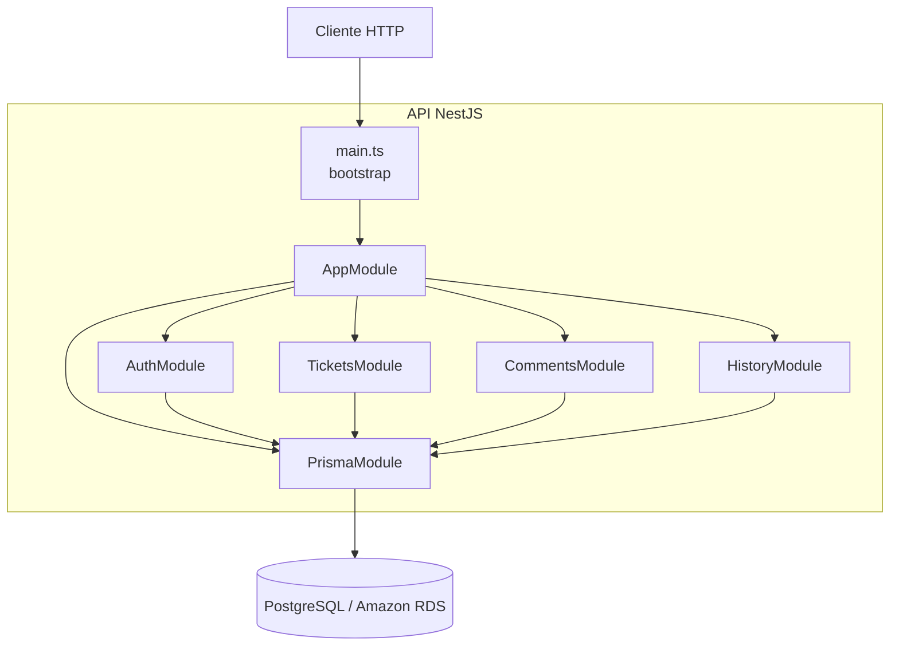
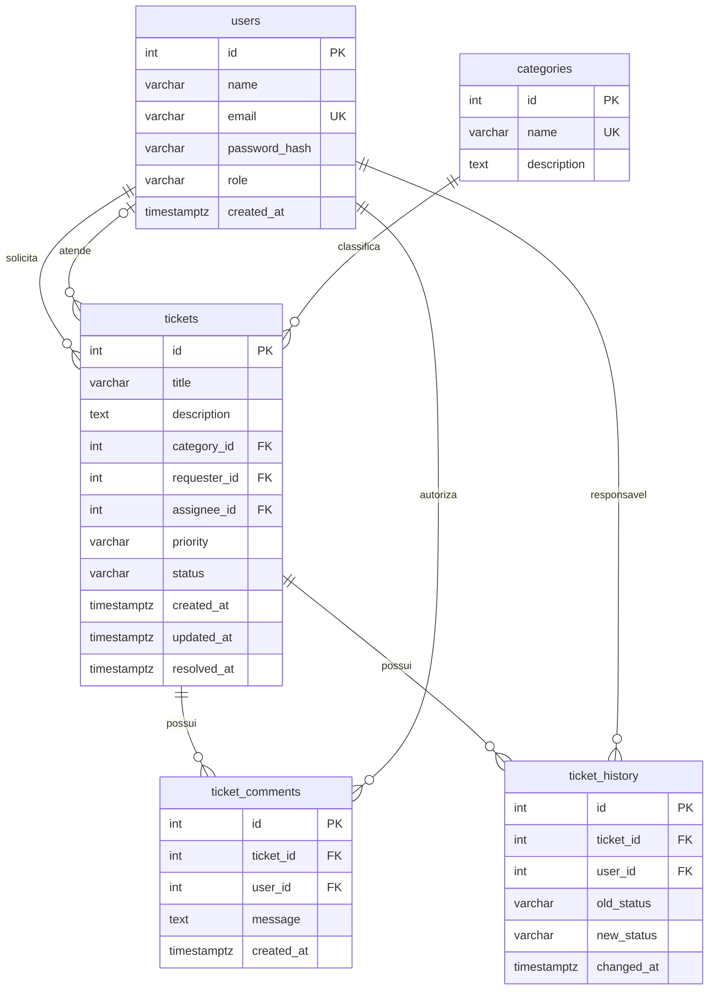

# Documentação técnica e arquitetura

## 1. Visão geral

O HelpDesk Cloud é uma API REST desenvolvida em NestJS para registrar, acompanhar e resolver chamados de suporte. A solução é organizada por módulos de domínio e persiste dados relacionais em PostgreSQL, atualmente por meio de Amazon RDS.

Objetivos principais:

- autenticar usuários;
- permitir a abertura de chamados;
- filtrar e paginar chamados;
- atribuir técnicos;
- atualizar status com rastreabilidade;
- registrar comentários;
- consultar o histórico de alterações.

## 2. Arquitetura lógica



### Camadas

1. **Controller**: define rotas, parâmetros HTTP e delega ao service.
2. **DTO**: valida e transforma dados de entrada.
3. **Service**: concentra consultas, transações e regras de aplicação.
4. **PrismaService**: cria o adaptador PostgreSQL, gerencia conexão e pool.
5. **Banco**: mantém entidades relacionais e integridade referencial.

O projeto não usa ainda uma camada explícita de repositório ou casos de uso separados. Cada service atua como aplicação dos casos de uso do módulo.

## 3. Inicialização

`main.ts` executa `NestFactory.create(AppModule)`, registra um `ValidationPipe` global com:

- `whitelist: true`: remove propriedades não declaradas nos DTOs;
- `transform: true`: converte entradas conforme os tipos disponíveis.

A porta é definida por `PORT` e assume `3000` quando ausente.

`AppModule` lê `.env` por meio de `ConfigModule.forRoot({ isGlobal: true })`.

## 4. Domínios e módulos

### 4.1 Aplicação

`AppController` expõe:

- `GET /`: status da aplicação;
- `GET /database/health`: executa `SELECT 1` e confirma disponibilidade.

### 4.2 Autenticação

O login consulta o usuário pelo e-mail, compara a senha com bcrypt e gera um JWT.

Payload utilizado:

```json
{
  "sub": 1,
  "role": "tecnico"
}
```

A estratégia JWT extrai o bearer token do cabeçalho `Authorization`, valida a assinatura e transforma o payload em:

```json
{
  "userId": 1,
  "role": "tecnico"
}
```

`GET /auth/profile` está protegido por `AuthGuard("jwt")`.

### 4.3 Chamados

`TicketsService` oferece:

- listagem paginada e filtrada;
- consulta detalhada;
- criação;
- atribuição;
- mudança de status.

As listagens usam uma transação Prisma para calcular dados e total em conjunto. A consulta detalhada inclui categoria, solicitante, técnico, comentários e histórico.

### 4.4 Comentários

Os comentários pertencem a um chamado e a um usuário. A criação valida:

- existência do chamado;
- existência do usuário;
- mensagem não vazia após `trim()`.

### 4.5 Histórico

Toda alteração de status registra `ticket_id`, `user_id`, status anterior e novo status. O histórico é exibido em ordem decrescente de data.

## 5. Modelo de dados



O esquema está em [prisma/schema.prisma](../prisma/schema.prisma). A migration inicial está em [prisma/migrations/20261110100811_init_schema/migration.sql](../prisma/migrations/20261110100811_init_schema/migration.sql).

## 6. Integridade e regras

### Relacionamentos

- um chamado tem uma categoria;
- um chamado tem um solicitante;
- um chamado pode ter um técnico atribuído;
- comentários e histórico são removidos em cascata com o chamado;
- categoria, solicitante e usuário não são removidos em cascata;
- a atribuição do técnico usa `SET NULL`;
- e-mails e nomes de categorias são únicos.

### Índices

Índices existem para categoria, técnico, solicitante, data de criação, prioridade e status dos chamados, além do relacionamento entre chamados e seus comentários ou histórico.

### Valores atuais

Os padrões identificados no código são:

- prioridade: `media`;
- status inicial: `aberto`;
- ao usar `resolvido`, `resolved_at` recebe a data atual;
- em outros status, `resolved_at` é zerado.

Não há uma enum Prisma ou validação completa de status/prioridade. Isso permite valores não padronizados caso os chamadores ignorem uma convenção externa.

## 7. Transações

O Prisma é utilizado em transações nos seguintes cenários:

- listagem de chamados e contagem total;
- alteração de status seguida de criação do histórico;
- atribuição do técnico;
- criação de comentário após validações.

Essas operações evitam persistência parcial dos registros dependentes.

## 8. Persistência e conexão

`PrismaService` usa `@prisma/adapter-pg` com pool configurado:

- máximo: 10 conexões;
- timeout de conexão: 5 segundos;
- timeout ocioso: 10 segundos;
- TLS com certificado CA;
- `rejectUnauthorized: true`.

O arquivo obrigatório é:

```text
certs/global-bundle.pem
```

A ausência do certificado impede a inicialização da aplicação.

## 9. API

### Resumo

| Recurso | Operações |
|---|---|
| Auth | login e perfil |
| Tickets | listar, obter, criar, atribuir, atualizar status |
| Comments | listar e criar |
| History | listar por chamado |
| Health | aplicação e banco |

### DTOs

| DTO | Campos |
|---|---|
| `LoginDto` | `email`, `password` |
| `CreateTicketDto` | `title`, `description`, `category_id`, `requester_id`, `priority?` |
| `AssignTicketDto` | `assignee_id` |
| `UpdateTicketStatusDto` | `status`, `user_id` |
| `CreateCommentDto` | `user_id`, `message` |

### Contratos de resposta

Os serviços produzem formatos variados:

- listagem: `{ data, pagination }`;
- chamado individual: objeto Prisma completo;
- mutações: `{ message, data }` ou `{ message, ticket }`;
- histórico: `{ ticket, total, history }`;
- erro: `NestException` com status HTTP e mensagem.

Não há Swagger/OpenAPI configurado. Para evolução, documentar os DTOs e respostas no Swagger é recomendado.

## 10. Deploy

O Docker adota build multi-stage:

1. imagem base Node 24 Alpine;
2. instalação limpa das dependências;
3. geração do Prisma;
4. compilação Nest;
5. remoção de dependências de desenvolvimento;
6. criação da imagem runtime;
7. aplicação das migrations;
8. execução da aplicação.

O entrypoint exige `DATABASE_URL` e `DIRECT_URL`.

Variáveis mínimas em runtime:

```text
DATABASE_URL
DIRECT_URL
JWT_SECRET
PORT
```

O projeto não possui configuração explícita de CORS, probes HTTP, healthcheck Docker ou múltiplas réplicas no repositório atual.

## 11. Testes

O projeto utiliza Jest 30 e possui testes unitários e E2E.

```bash
npm run test
npm run test:e2e
npm run test:cov
npm run typecheck
npm run lint
```

O teste E2E atual inicializa `AppModule`, mas sua expectativa ainda é diferente da resposta implementada em `AppController`. Esse teste deve ser atualizado antes de servir como validação confiável.

Os testes de service presentes verificam principalmente a instanciação dos serviços. Recomenda-se adicionar mocks de `PrismaService` para testar:

- filtros e paginação;
- criação e atribuição;
- transações de status;
- histórico;
- comentários;
- login, senha inválida e usuário inexistente;
- erros 404 e 400.

## 12. Dívida técnica e evoluções recomendadas

### Segurança

- aplicar `AuthGuard("jwt")` às operações privadas;
- derivar `user_id` de `req.user`;
- implementar autorização por papel;
- impedir acesso a recursos fora do contexto do usuário;
- proteger alterações administrativas.

### Validação

- criar enums ou objetos de domínio para status e prioridade;
- validar existência de categoria e solicitante na criação;
- definir transições válidas de status;
- impedir atribuição de usuário que não seja técnico.

### API

- configurar Swagger/OpenAPI;
- padronizar o formato de sucesso e erro;
- adicionar códigos de erro estáveis;
- habilitar CORS somente para origens conhecidas;
- implementar rate limiting.

### Operação

- integrar NestJS Observe;
- adicionar logs estruturados;
- criar healthcheck sem vazamento de infraestrutura;
- definir graceful shutdown;
- configurar limites e métricas;
- adicionar pipelines de lint, build, test e migration.

### Banco

- adicionar constraints para status e prioridade;
- centralizar regras de auditoria;
- avaliar soft delete;
- manter migration e seed separados;
- definir estratégia de rollback.
